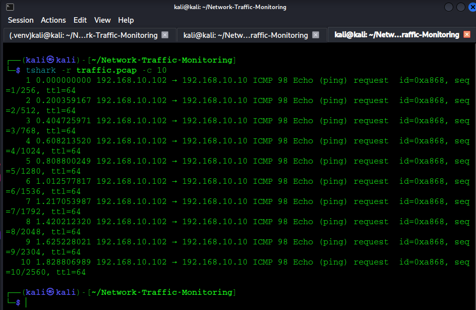
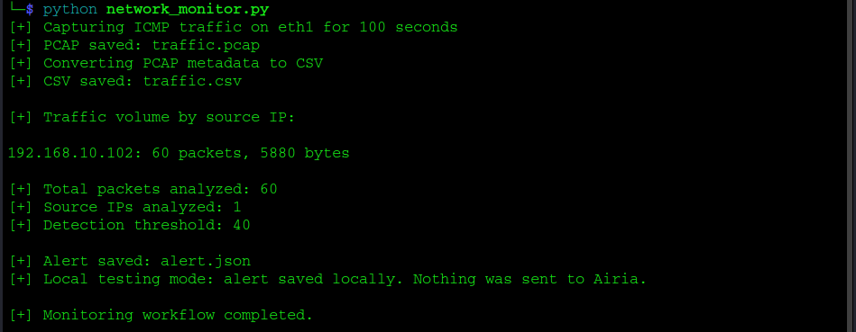
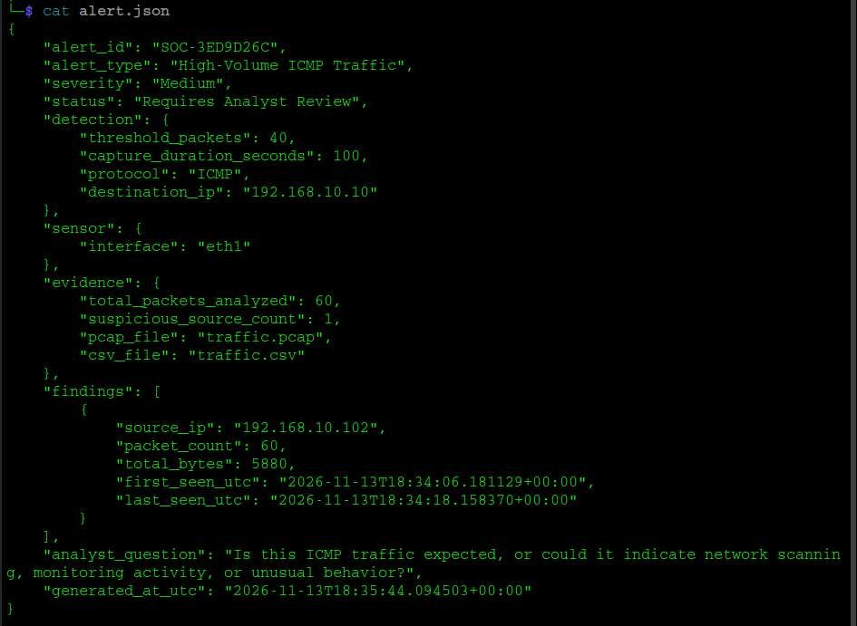
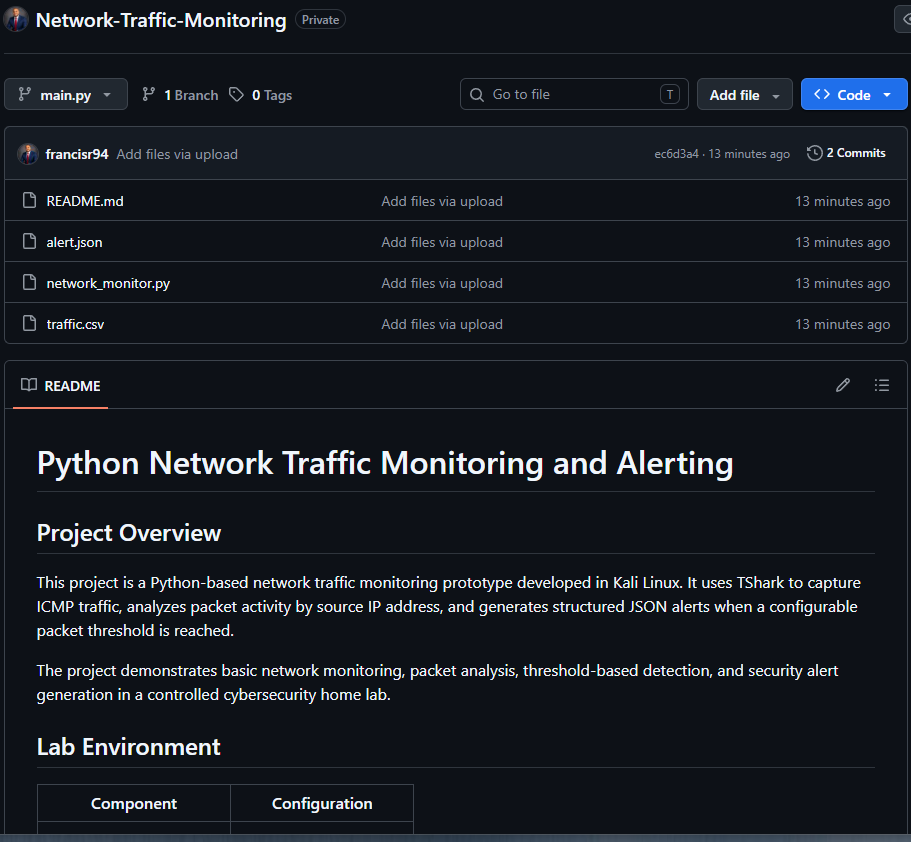

# Python Network Traffic Monitoring and Alerting

## Project Overview

This project is a Python-based network traffic monitoring prototype developed in Kali Linux. It uses TShark to capture ICMP traffic, analyzes packet activity by source IP address, and generates structured JSON alerts when a configurable packet threshold is reached.

The project demonstrates basic network monitoring, packet analysis, threshold-based detection, and security alert generation in a controlled cybersecurity home lab.

## Lab Environment

| Component | Configuration |
|---|---|
| Monitoring system | Kali Linux |
| Programming language | Python 3 |
| Packet capture tool | TShark |
| Network interface | eth1 |
| Network | CorpLAN |
| Target system | Windows Server DC01 |
| Target IP | 192.168.10.10 |
| Monitoring duration | 100 seconds |
| Detection threshold | 40 packets |

## Project Features

- Captures IPv4 ICMP traffic using TShark.
- Saves packet captures in PCAP format.
- Extracts packet metadata into CSV.
- Groups traffic by source IP address.
- Counts packets and calculates total bytes.
- Identifies sources meeting a configurable packet threshold.
- Generates structured JSON security alerts.
- Supports optional integration with an external Airia endpoint.

## Detection Logic

The prototype monitors ICMP traffic destined for DC01.

A source IP is flagged for analyst review when it generates at least 40 packets during the 100-second capture.

This is a total-capture threshold, not a rolling time-window detection.

## Testing and Results

### Controlled ICMP Detection Test

A controlled test was performed by sending 60 ICMP echo requests from Kali Linux to DC01.

**Test results:**

| Metric | Result |
|---|---:|
| Source IP | 192.168.10.102 |
| Destination IP | 192.168.10.10 |
| Protocol | ICMP |
| Packets captured | 60 |
| Total bytes | 5,880 |
| Detection threshold | 40 |
| Alert generated | Yes |

### Alert Output

The script successfully generated `alert.json` with:

- Unique alert identifier
- Alert type and severity
- Detection threshold
- Source IP address
- Packet count and total bytes
- First-seen and last-seen timestamps
- Analyst review question

**Test conclusion:** The monitoring prototype successfully captured the controlled ICMP traffic, identified the source exceeding the configured threshold, and generated a structured alert.

The traffic was intentionally generated for testing. A high ICMP packet count is an indicator for investigation, not proof of malicious activity.

## Project Files

| File | Purpose |
|---|---|
| `network_monitor.py` | Main monitoring and detection script |
| `traffic.pcap` | Captured network traffic |
| `traffic.csv` | Extracted packet metadata |
| `alert.json` | Generated security alert |
| `README.md` | Project documentation |

## Skills Demonstrated

- Python scripting
- Kali Linux
- Network traffic monitoring
- TShark and packet capture
- PCAP and CSV analysis
- JSON alert generation
- Basic detection engineering
- SOC analyst investigation workflow

## Future Improvements

- Add rolling time-window detection.
- Integrate alerts with Splunk Enterprise.
- Validate and implement Airia API integration.
- Add configurable detection rules.
- Include additional network protocols.
- Improve alert severity and contextual enrichment.

## Disclaimer

This project is an educational cybersecurity lab prototype. Testing was performed on an authorized private home-lab network. The detection logic is intended for analyst review and is not a production-grade intrusion detection system.

## 📸 Project Screenshots

### 1. Network Packet Capture

### 2. Detection Results

### 3. Generated Security Alert

### 4. GitHub Project Overview

